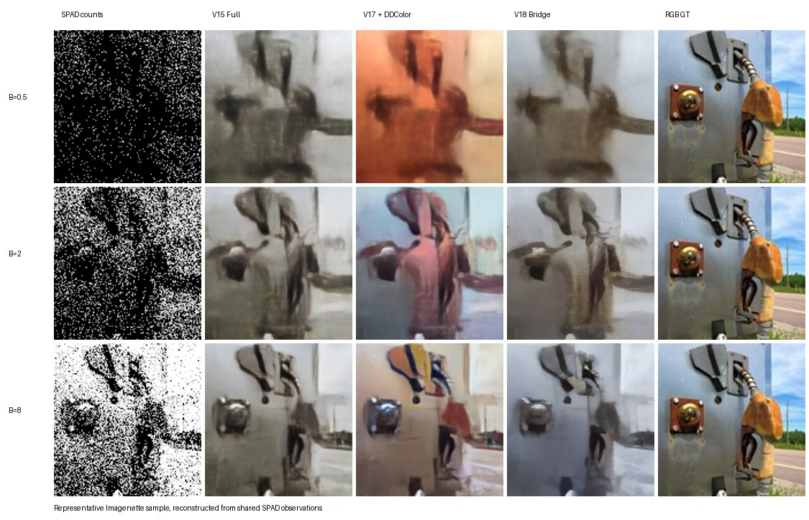
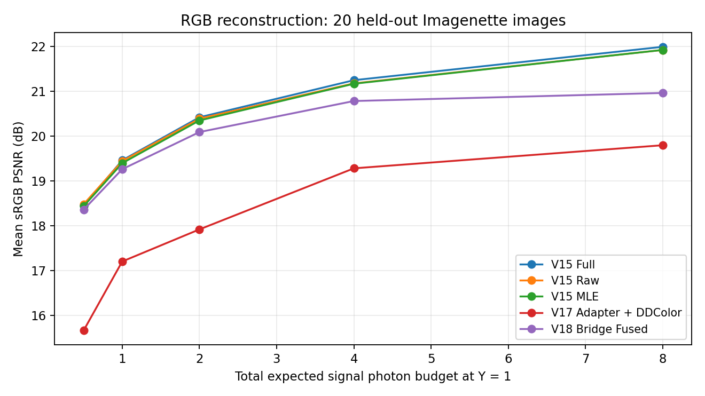
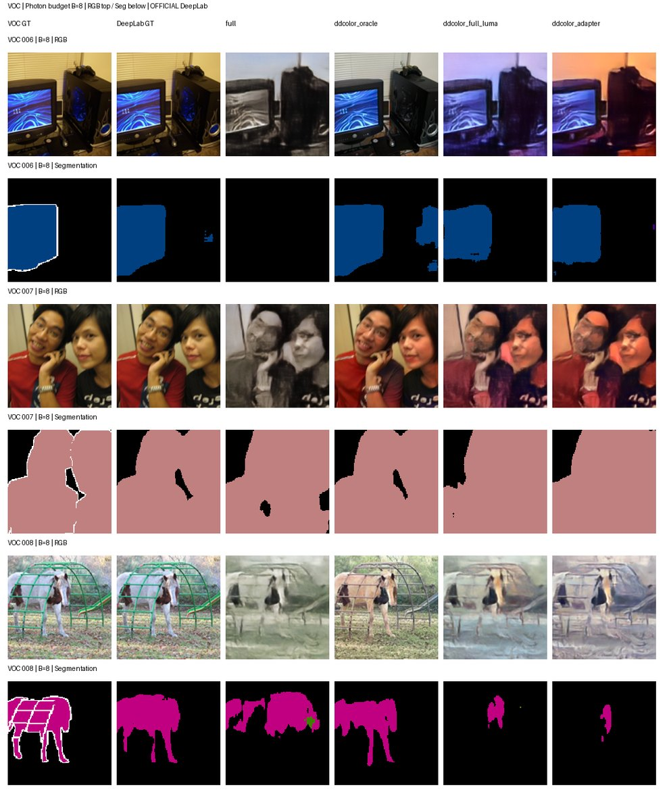
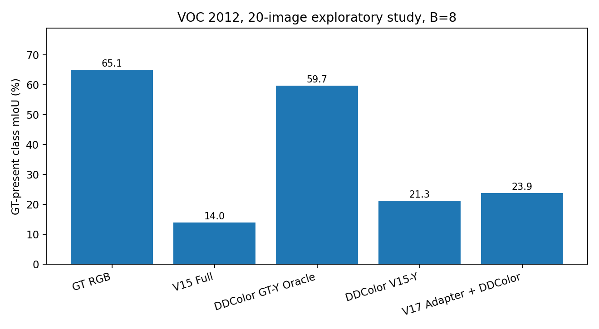

# Sparse SPAD-to-RGB Reconstruction

**Single-channel photon counts → RGB reconstruction → downstream semantic segmentation.**  
A compact PyTorch research repository with **two Python source files**: `spad.py` (CLI and experiments) and `spad_core.py` (physics, architectures and checkpoint-compatible loaders).

> **Research status.** This is an exploratory benchmark, not a claim that single-channel SPAD measurements uniquely determine color. Existing model weights and full datasets are intentionally **not included** in Git. Experiments assume a **static scene and known exposure calibration**.

## Results at a glance



*Representative held-out Imagenette scene with identical simulated photon measurements for the methods in each row. Columns are Count image (display), V15 Full, V17 Adapter + DDColor, V18 Bridge, and GT RGB. These are actual recorded experiment images, not synthetic mockups; display crops are for illustration only.*



The strongest **RGB-fidelity baseline** in the evaluated 20-image Imagenette sample was **V15 Full**. At the tested budget **B = 8**, it achieved **21.99 dB sRGB PSNR** and **0.724 SSIM**. At **B = 0.5**, V15 Raw was marginally ahead of V15 Full by approximately 0.03 dB. These small-sample rankings should not be presented as statistically conclusive or as a full ImageNet result.

### Downstream semantic segmentation



*Actual VOC 2012 image/segmentation gallery, B = 8. The DDColor Oracle receives **ground-truth luminance** and is a **diagnostic reference only**, not an inference method available from SPAD measurements.*



On the recorded **20-image VOC 2012 exploratory set** (fixed official Torchvision DeepLabV3 preprocessing, B = 8), V17 Adapter + DDColor reached **23.85% GT-present-class mIoU** versus **13.99%** for V15 Full; the **GT-luminance DDColor Oracle** reached **59.74%**. The same VOC scenes were repeatedly inspected during development, so these are **exploratory results**, not an untouched final test benchmark.

| Role | Method (`--model`) | Checkpoint |
|---|---|---|
| Main RGB fidelity model | `full` | `runs/v15_64/full_best.pt` |
| Direct baselines | `raw`, `mle` | `runs/v15_64/{raw,mle}_best.pt` |
| Downstream segmentation comparator | `adapter_ddcolor` | `runs/v17_adapter/luma_adapter_best.pt` + pretrained DDColor |
| Optional latent baseline | `bridge_fused` | `runs/v18_bridge_fast/bridge_best.pt` + pretrained SD-VAE |
| GT-aware diagnostic only | `ddcolor_oracle` | Requires RGB GT, **not deployable** |

## Measurement model

For static linear-light luminance \(Y=0.2126R+0.7152G+0.0722B\), with \(T=64\) binary exposures, the aggregated count obeys

\[
K\sim\operatorname{Binomial}\!\left(T,1-\exp\!\left[-\frac{B Y+b}{T}\right]\right),
\]

where **B is the total expected signal photon budget at \(Y=1\)** over all exposures (not an observed image-wide mean), and **b is the total background budget**. Optional Poisson acquisition is also supported. Five input channels are assembled from counts, inverse-response intensity, bilateral-filtered intensity, uncertainty and exposure. A calibrated mono sensor yields **luminance information**; absolute RGB color remains ambiguous without additional spectral measurements or learned image priors.

## Files

```text
spad.py                    # Train / resume / infer / RGB eval / VOC eval / plot / check
spad_core.py               # Physics + 5-channel features + V15/V17/V18 architectures
README.md
requirements.txt
.gitignore
docs/figures/              # Small, versioned benchmark figures
archive/                   # Git ignored: historical scripts
runs/                      # Git ignored: checkpoints, tensorboard, CSV outputs
data/                      # Git ignored: datasets / observed photon counts
external/                  # Git ignored: DDColor source
papers/                    # Git ignored: personal papers and references
```

The five large local folders above are in `.gitignore`. **Ignoring does not delete your files.** If they have already been tracked, see the Git section below.

## Installation (Windows / PowerShell)

Use Python 3.10+ with a PyTorch version appropriate for your NVIDIA driver and CUDA runtime. Install PyTorch and torchvision using the [official selector](https://pytorch.org/get-started/locally/) first. Then:

```powershell
cd D:\low_count_to_rgb
conda activate pytorch
python -m pip install -r requirements.txt
# Official third-party source needed only for DDColor-based methods:
if (-not (Test-Path external/DDColor/ddcolor)) { git clone https://github.com/piddnad/DDColor.git external/DDColor }
```

DDColor's own dependencies may also need installation as documented by its upstream repository. The optional Bridge model requires `diffusers`/Hugging Face models and downloads SD-VAE weights on first use.

**Data layout:** `data/imagenette2-160/train/<class>/*.JPEG` and `data/imagenette2-160/val/<class>/*.JPEG`. The program deterministically splits the original Imagenette validation folder using `--seed 42 --val-count 500`, reserving one segment for checkpoint selection and the remainder for local testing. VOC requires Torchvision's `VOCSegmentation` layout under `data/VOC` (VOC 2012 validation), with pixel-level masks. Do **not** use VOC validation labels for training and call it an untouched test set.

## CLI quick start

**1. Verify legacy model weights and settings:**

```powershell
python spad.py check --device cuda
```

**2. Evaluate multiple existing models using exactly the same photon realization per scene and budget:**

```powershell
python spad.py rgb --models raw mle full adapter_ddcolor --device cuda --split test --eval-images 20
```

Output: `runs/spad_final/rgb_test/summary.csv`, `metrics.csv`, galleries `0000.png` … . Set `--eval-images 0` for the full available split.

**3. Evaluate semantic segmentation with a frozen, officially preprocessed DeepLabV3:**

```powershell
python spad.py seg --models full adapter_ddcolor --device cuda --segmentor resnet50 --eval-images 20
```

Output: `runs/spad_final/seg_voc/summary.csv`, `per_image.csv`, `seg_gallery_B*.png`. The default `--skip-images 6` excludes images previously used for checkpoint-selection previews; for genuinely untouched evaluation use a separately reserved split.

**4. Train models (new files, original checkpoints stay intact):**

```powershell
# V15: train all three direct RGB variants, with independent weights:
python spad.py train --models raw mle full --epochs 10 --batch 8 --amp fp16 --tensorboard --device cuda

# V17: train one photon-to-luminance Adapter:
python spad.py train --model adapter --epochs 10 --batch 8 --amp fp16 --tensorboard --device cuda

# Optional: V18 photon-conditioned Bridge, uses frozen V17 + pretrained VAE:
python spad.py train --model bridge --base 64 --epochs 5 --batch 2 --amp fp16 --tensorboard --device cuda
```

Default training destination: `runs/spad_training/v15_64/`, `runs/spad_training/v17_adapter/`, or `runs/spad_training/v18_bridge/`. These checkpoints use the same model architecture/state naming and can be evaluated by specifying the relevant `--v15-out`, `--v17-out` or `--v18-out` folder. **This is a compatible training implementation, not a promise of bit-for-bit recreation of the historical optimizers or training schedule.** Use the same acquisition parameters (`--mode`, `--cycles`, `--bg`, `--size`, bilateral-filter parameters) as your checkpoints.

**5. Resume training from an optimizer-state checkpoint:**

```powershell
python spad.py train --model full --epochs 15 --resume-from runs/spad_training/v15_64/full_last.pt --batch 8 --device cuda
```

`--epochs` is the **total**, not an additional number of epochs. Loading an older `*_best.pt` without optimizer state is a **weights-only warm-start**, not an exact continuation. To avoid accidental overwrite, the program refuses to overwrite an existing best checkpoint unless performing an explicit same-directory resume or using `--overwrite`.

**6. Infer from actual photon count arrays, without an RGB GT:**

```powershell
# Counts H×W in [0,T], or .npz with key 'counts' or binary 'frames' [T,H,W]:
python spad.py infer --input data/example_counts.npy --model full --budget 8 --cycles 64 --bg 0.01 --size 128 --device cuda

# Generate a synthetic measurement from a normal RGB photo (demonstration only):
python spad.py infer --input my_photo.jpg --simulate --model full --budget 8 --device cuda
```

**Important:** never resize a physical count image for convenience. `--size` must match the sensor/count-array shape and the trained checkpoint; the photon budget and background must come from calibration. RGB JPEG inputs are accepted only under the explicit `--simulate` option. Outputs go to `runs/spad_final/infer/` as full RGB PNGs, a per-sample gallery, and original numeric counts.

**7. Export curves and inspect TensorBoard:**

```powershell
python spad.py plot --out runs/spad_final
python -m tensorboard.main --logdir runs/spad_training --port 6006
```

`plot` supports custom CSVs with `--plot-csv <file1.csv> <file2.csv>`; it exports PNG figures to `runs/spad_final/plots/`. Training records **both train and val image galleries** plus scalar losses to TensorBoard. Optional `--max-batches 5 --epochs 1` gives a quick smoke test before a costly run.

## Reproducibility and interpretation

- **Photon protocol:** 64 exposures, Bernoulli acquisition, B ∈ {0.5, 1, 2, 4, 8}, background total b = 0.01, linear-light sRGB luminance, image size 128×128, deterministic `--seed 42`.
- **Fair comparisons:** all methods see **the same simulated count realization** for a given image/B in one evaluation run. DDColor-Oracle is marked separately because it accesses GT.
- **Selection/evaluation:** use a separate validation set for model selection, then a fully independent held-out set for publication. Small 12/20/30-image exploratory reports are not significance claims.
- **Scientific limitations:** single-channel counts do not identify real chroma; latent Bridge and PnP did not reliably improve RGB fidelity in these experiments. More saturated output is not proof of correct color.
- **Checkpoint safety:** treat checkpoints from untrusted parties as unsafe when loaded with pickle-aware `torch.load`. Load only your own or verified weights.
- **Hardware:** the consolidated two-file code was tested on CPU with compatible checkpoint formats and simulated VOC/Bridge dependencies. **Actual DDColor / SD-VAE weights and Windows CUDA have not been run in this build environment.**

## Git: first commit or update

```powershell
cd D:\low_count_to_rgb
# Check that .gitignore excludes the large folders:
git check-ignore archive data external papers runs

# If large folders had already been committed, remove them from Git's index only:
# (The --cached flag keeps all local files untouched.)
git rm -r --cached --ignore-unmatch archive data external papers runs

git add spad.py spad_core.py README.md requirements.txt .gitignore docs/figures
git status
git commit -m "Consolidate SPAD training, inference, evaluation and figures"
git remote -v
git push -u origin main
```

If the project is not yet initialized, run `git init` and `git branch -M main` before the commit. If `origin` is missing, attach **your own** GitHub repository with `git remote add origin git@github.com:YOUR_ACCOUNT/YOUR_REPOSITORY.git`. GitHub no longer supports account-password authentication for HTTPS Git pushes; use SSH or a supported credential manager/personal access token. `.gitignore` and `git rm --cached` remove large data from **future tracking**, not from earlier Git history.

---

*Research artifact assembled from the user's V15–V20 SPAD experiments. Figure results are explicitly labeled as exploratory and should be replicated on an untouched test set before publication.*
