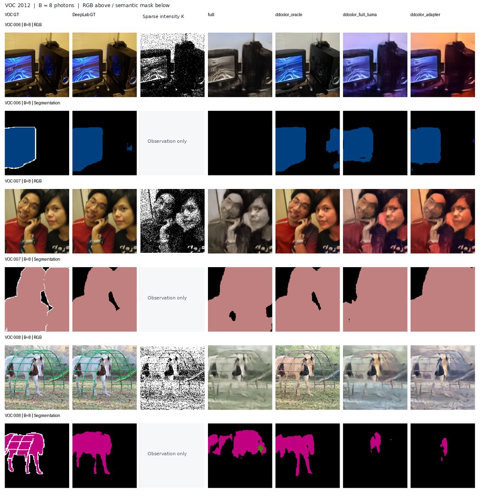

# Sparse SPAD-to-RGB Reconstruction

Reconstructing RGB images and evaluating downstream visual understanding from **low-photon, single-channel SPAD observations**.

## RGB reconstruction


## Semantic segmentation



*RGB above; semantic masks below. The **Sparse intensity K** column illustrates a separate 64-exposure Bernoulli measurement simulated from each displayed GT crop at B = 8; it is **not the exact realization** used to produce the previously saved RGB reconstructions. Running `spad.py seg` generates galleries with the **actual shared photon counts** used by every compared model (recommended before publication).*

## Overview

- **Measurement:** 64 binary SPAD exposures per pixel, aggregated into photon hit counts.
- **Main RGB baseline:** V15 Full (lightweight photon-to-RGB U-Net).
- **Downstream comparator:** V17 luminance Adapter + frozen DDColor.
- **Evaluation:** RGB PSNR/SSIM and frozen DeepLabV3 segmentation on VOC 2012.
- **Limit:** single-channel intensity measurements do not uniquely determine true RGB color.

This repository contains two Python modules: `spad.py` (training, inference, evaluation, visualization CLI) and `spad_core.py` (physical model and network implementations). Data, pretrained weights, and experimental checkpoints are not included.

```powershell
python -m pip install -r requirements.txt
python spad.py check --device cuda
python spad.py rgb --models raw mle full adapter_ddcolor --device cuda --eval-images 20
python spad.py seg --models full adapter_ddcolor --device cuda --eval-images 20
```

The displayed results are **exploratory examples from limited evaluation subsets**, not performance claims on a fully independent benchmark. The GT-luminance Oracle appearing in the segmentation figure uses privileged ground-truth information and is **not deployable**.
